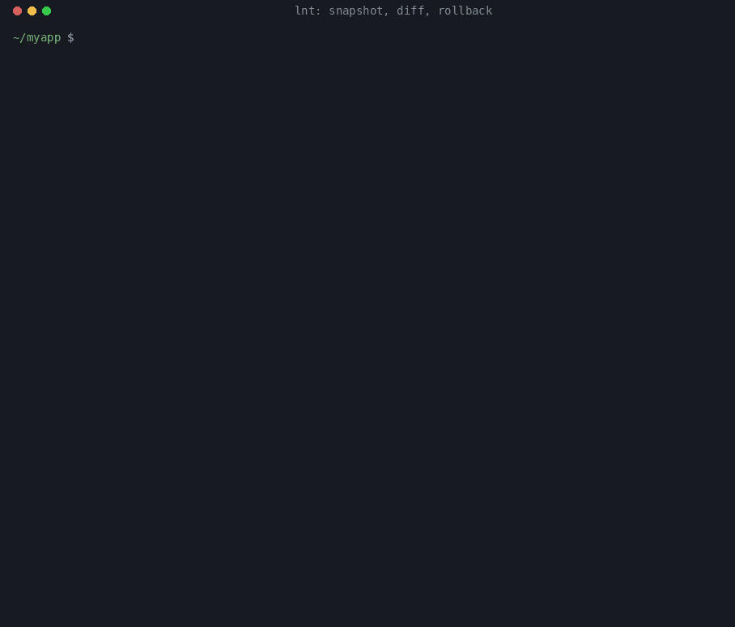

<p align="center"></p>

# Leave No Trace (`lnt`)

**Your AI agent made a mess. See every trace, and undo it.**

**Snapshot the machine before an agent session, diff it afterwards, roll back what it left behind.**

[](https://github.com/Maftuuh1922/leave-no-trace/actions/workflows/ci.yml)
[](LICENSE)
[](pyproject.toml)
[](#supported-platforms)
[](SKILL.md)

<p align="center"></p>

`lnt` snapshots your machine before a coding-agent session, diffs it afterwards,
and prints a receipt of everything the session left **outside the diff you asked
for**: junk files in the repo and `/tmp`, global packages, dotfiles,
`git config --global`, agent configs/hooks/MCP servers, processes and ports still
running, docker containers, cron/launchd/systemd jobs. Every line has evidence
(sha256, or PID + start time + cwd). `lnt revert` shows the rollback plan,
`lnt revert --apply` carries it out and checks each item against the baseline.
What it can and cannot roll back is spelled out [below](#what-can-be-rolled-back).

## 30-second install

```bash
# Claude Code (other agents: see the table under "Install" below)
git clone https://github.com/Maftuuh1922/leave-no-trace ~/.claude/skills/leave-no-trace

# or one copy for Codex, Gemini CLI, Cursor and opencode at once
git clone https://github.com/Maftuuh1922/leave-no-trace ~/.agents/skills/leave-no-trace

# or just the CLI
pip install git+https://github.com/Maftuuh1922/leave-no-trace
```

Python 3.8+, no dependencies. The skill tells the agent to run `lnt snapshot` at
the start and `lnt diff` before it says "done". By hand:

```bash
lnt snapshot              # before the session
lnt diff                  # after: exit 1 = something was left behind
lnt revert                # dry run: the rollback plan, nothing changes (same as --dry-run)
lnt revert --apply        # roll back; asks first before anything that cannot be undone
```

## Demo (real output)

The GIF above and the text below are the same run, recorded with
[`docs/demo/record.py`](docs/demo/record.py) in a throwaway `HOME`/`TMPDIR`/repo
(packages and docker collectors switched off there). The "agent session" is a
shell script that drops a `tmpclaude-*-cwd` file, adds a `SessionStart` hook,
changes `git config --global user.email`, appends to `~/.bashrc`, leaves task
output in the temp dir and a dev server listening on a port. Only the temp-dir
prefix is shortened; the asciinema recording is [`docs/demo/demo.cast`](docs/demo/demo.cast)
(`asciinema play docs/demo/demo.cast`) and the full text is
[`docs/demo/session.txt`](docs/demo/session.txt).

```
$ lnt snapshot
lnt: baseline saved (29 items, 0.02s) → ~/.local/state/lnt/myapp-b41ef5fdd89a/default
lnt:   cron: missing
lnt:   docker: disabled
lnt:   packages: disabled

$ sh ~/agent-session.sh
agent: done!

$ lnt diff
━━ Leave No Trace receipt ━━
repo: ~/myapp   session: 2026-10-16 10:57:48 → 2026-10-16 10:57:48
This session left 8 things outside the requested work: 1 agent config/hook change, 2 running processes/ports/containers, 3 global environment changes, 2 leftover files.

 1. [AGENT-CONFIG] HIGH new agent config/hook: ~/.claude/settings.json
      evidence: sha256 5f9af3c3405b, 90 B, mode 0o644
      revert:   move to trash: ~/.claude/settings.json
 2. [RUNNING] MEDIUM new listening port 48765 (pid 8110)
      evidence: pid 8110 started 2026-10-16 10:57:47
      revert:   covered by stopping the process that owns port 48765
 3. [RUNNING] MEDIUM process still running: pid 8110 `python3 -m http.server 48765 --bind 127.0.0.1`
      evidence: pid 8110, started 2026-10-16 10:57:47, cwd ~/myapp
      revert:   stop pid 8110 (started 2026-10-16 10:57:47) and its new children
 4. [ENV] MEDIUM changed dotfile: ~/.bashrc
      evidence: sha256 b685fa9d4a→9d358a2ff3, 66 B, mode 0o644
      revert:   restore ~/.bashrc from the baseline copy
 5. [ENV] MEDIUM changed dotfile: ~/.gitconfig
      evidence: sha256 668c077f86→3cd5ae44fe, 46 B, mode 0o644
      revert:   restore ~/.gitconfig from the baseline copy
 6. [ENV] MEDIUM git config --global user.email = agent@example.com
      revert:   covered by restoring the global git config file
 7. [LITTER] LOW new untracked file in repo: tmpclaude-3f2a-cwd
      evidence: sha256 e3b0c44298fc, 0 B, mode 0o644
      revert:   move to trash: tmpclaude-3f2a-cwd
 8. [LITTER] LOW new temp dir (195.3 KB): /tmp/lntdemo/claude-1000
      evidence: 195.3 KB
      revert:   move to trash: /tmp/lntdemo/claude-1000

0 in-scope change(s), 0 ignored finding(s).
(exit 1)

$ lnt revert
lnt revert plan (dry run; nothing was changed). Re-run with --apply to execute.
  1. [kill] stop pid 8110 (started 2026-10-16 10:57:47) and its new children  ! irreversible
      for: process:python3:8110
  2. [trash] move to trash: ~/.claude/settings.json
      for: agentconfig:~/.claude/settings.json
  3. [restore] restore ~/.bashrc from the baseline copy
      for: dotfile:~/.bashrc
  4. [restore] restore ~/.gitconfig from the baseline copy
      for: dotfile:~/.gitconfig
  5. [trash] move to trash: tmpclaude-3f2a-cwd
      for: repo.untracked:tmpclaude-3f2a-cwd
  6. [trash] move to trash: /tmp/lntdemo/claude-1000
      for: tmp:/tmp/lntdemo/claude-1000
  7. [covered] covered by stopping the process that owns port 48765
      for: port:tcp:48765
  8. [covered] covered by restoring the global git config file
      for: gitconfig:user.email
lnt: 1 action(s) cannot be undone (stopping processes, uninstalling packages, removing docker objects); --apply asks before running them, or pass --yes.

$ lnt revert --apply --yes
  1. done         process:python3:8110 - SIGTERM
  2. done         agentconfig:~/.claude/settings.json - moved to trash: ~/.claude/settings.json
  3. done         dotfile:~/.bashrc - restored from the baseline copy
  4. done         dotfile:~/.gitconfig - restored from the baseline copy
  5. done         repo.untracked:tmpclaude-3f2a-cwd - moved to trash: ~/myapp/tmpclaude-3f2a-cwd
  6. done         tmp:/tmp/lntdemo/claude-1000 - moved to trash: /tmp/lntdemo/claude-1000
  7. skipped      port:tcp:48765 - covered by stopping the process that owns port 48765
  8. skipped      gitconfig:user.email - covered by restoring the global git config file
lnt: 8/8 reverted item(s) verified back at their baseline state. Trash: ~/.local/state/lnt/myapp-b41ef5fdd89a/default/trash/20261016-105748

$ lnt diff
━━ Leave No Trace receipt ━━
repo: ~/myapp   session: 2026-10-16 10:57:48 → 2026-10-16 10:57:49
Clean: nothing changed outside the requested work.

0 in-scope change(s), 0 ignored finding(s).
```

`lnt diff` exits 1 because something was left behind. The dry run marks the one
action that cannot be undone (stopping the server); `--yes` allows it without a
prompt. After the rollback, `~/.bashrc` and `~/.gitconfig` are byte-identical to
the baseline, the removed files sit in the session trash folder (never deleted),
and the second `lnt diff` is clean.

## How it works

1. **`lnt snapshot`** records a baseline in `~/.local/state/lnt/<repo>/<session>/`
   (never inside the repo): sha256 of untracked repo files, temp-dir entries,
   dotfiles and agent configs; a copy of each small config file (≤512 KB, mode
   0600, credential files excluded); `git config --global`; global package lists
   with versions; your processes with PID, start time, cwd and process group;
   TCP listeners; docker objects; crontab and user units/LaunchAgents.
2. **`lnt diff`** takes the same snapshot again and compares. Tracked-file edits
   and new files inside `--scope` count as the requested work; everything else is
   a finding with a severity and evidence. Exit code `0` clean, `1` findings,
   `3` no baseline.
3. **`lnt revert`** turns each finding into one action (trash, restore, command,
   kill, crontab, git, manual) and prints the plan. Nothing changes unless you add
   `--apply`.
4. **`lnt revert --apply`** re-reads every item first and skips it if it changed
   since the diff, runs the action, takes a third snapshot and verifies each item
   is back at its baseline state. Exit `0` only if every item verified and nothing
   was left manual or refused.

It reads machine state, not the agent's transcript, so it gives the same answer
for any agent, model or a human at a terminal.

## Why not git, Docker or filesystem snapshots?

Use them too; they answer different questions.

| Tool | What it covers | What `lnt` adds |
|---|---|---|
| **git** (`git status`, `git stash`, `git clean`) | files inside the repo | Everything outside the repo: `~/.bashrc`, `git config --global`, agent hooks and MCP servers, global npm/pip/cargo/brew packages, processes and ports, docker objects, cron/systemd/launchd jobs. Inside the repo it also catches changes to `.git/config` and `.git/hooks`, which `git status` does not show. |
| **Docker / devcontainers / VMs** | isolation: the session cannot touch the host at all | Nothing to set up, and it works when the agent has to run on your real machine (your toolchain, credentials, GUI apps, hardware). It does **not** isolate anything; if you can run the agent in a container, that is the stronger option. |
| **Filesystem snapshots** (btrfs, ZFS, APFS/Time Machine, Timeshift) | whole volumes or subvolumes, at block or file level | Works on any filesystem without root. Says *what* changed, item by item, with evidence, and rolls back only those items, so your own work from the same hour is not rolled back with them. Covers running processes, listening ports and docker state, which a filesystem snapshot does not. Timeshift [excludes home directories by default](https://github.com/linuxmint/timeshift#user-data-is-excluded-by-default), which is where dotfiles and agent configs live. |
| **Command guards** (`destructive_command_guard`, `cc-safety-net`) | block known-bad commands *before* they run | Records what actually changed, including changes made by the agent harness itself, which a guard cannot block. |

## What can be rolled back

| What the session did | `lnt revert --apply` | Reversible? |
|---|---|---|
| Created a file or directory (repo litter, temp dir, dotfile, agent config, `~/.local/bin` executable) | moves it to the session trash | yes: it is in the trash folder |
| Changed a dotfile or agent config that had a baseline copy (≤512 KB) | writes the baseline copy back; the current version goes to the trash first | yes |
| Changed only the MCP/hook sections of `~/.claude.json` | restores those sections, leaves the rest (counters, history) alone; full previous file to trash | yes |
| Changed `git config --global` | restores the config file, or `git config --unset-all/--add` with the baseline values | yes: replaced values are in `diff.json` |
| Added a crontab entry | installs the baseline crontab; the current one is saved to the trash first | yes |
| Added a systemd user unit / LaunchAgent | `systemctl --user disable --now` / `launchctl bootout`, then unit file to trash | file yes; the stopped service is not restarted |
| Left a process or dev server running | SIGTERM (process group if it leads a new one), SIGKILL after 3 s; only if PID, start time and UID still match | **no**: asks first |
| Installed a global package (npm, pnpm, pip, pipx, uv, cargo, brew, gem) | uninstalls it | **no**: asks first |
| Upgraded, downgraded or removed a global package (npm, pnpm, pip, pipx, uv, cargo) | reinstalls the baseline version from the registry (needs network) | **no**: asks first |
| Created a docker container, volume, network or image | `docker rm -f` / `volume rm` / `network rm` / `rmi` | **no**: data in it is gone; asks first |
| Changed an existing repo file that is untracked or ignored | nothing (repo files are hashed, not copied) | manual: use git or your backup |
| Changed a credential file (`.netrc`, `.aws/credentials`, `gh/hosts.yml`, ...) | nothing (never copied) | manual |
| Deleted a watched file or docker object that existed before, or stopped a server that was listening before (seen as a vanished port) | nothing; it is reported, not recreated. Temp-dir deletions and pre-existing processes that exit without a port are not reported | manual |
| Changed a dotfile larger than 512 KB, or with `"backup": false` | nothing | manual |
| `brew`/`gem` upgrade or removal | nothing | manual |
| Anything outside the watched paths (e.g. `~/Documents`, `/etc`, system packages) | not seen at all unless added via `extra_files`/`extra_dirs` | n/a |

**Irreversible actions need confirmation.** On a terminal, `--apply` lists them
and asks `[y]es / [s]kip them, revert the rest / [N]o, abort`. Without a terminal
(an agent, CI) they are refused and reported as `refused`, the reversible actions
still run, and the exit code is 1; pass `--yes` to allow them. `lnt revert` (or
`--dry-run`) shows the whole plan with irreversible actions marked, and changes
nothing.

## Proof: this happens in public bug trackers

Each of these was opened and read on 2026-10-12. Dates are when the issue was filed (UTC).

| Filed | Issue | What it says |
|---|---|---|
| 2025-06-11 | [claude-code#1935](https://github.com/anthropics/claude-code/issues/1935) | "Claude Code does not properly clean up MCP server processes when exiting, leading to orphaned processes" |
| 2025-10-03 | [claude-code#8856](https://github.com/anthropics/claude-code/issues/8856) | `/tmp/claude-*-cwd` files "are never cleaned up … 174 files accumulated in one day of usage" |
| 2025-10-24 | [claude-code#10230](https://github.com/anthropics/claude-code/issues/10230) | "automatically creates `~/.config/git/ignore` … without asking for user permission" |
| 2026-01-09 | [claude-code#17087](https://github.com/anthropics/claude-code/issues/17087) | "creates empty (0 byte), read-only (-r--r--r--) dotfiles in the current working directory" |
| 2026-01-12 | [claude-code#17600](https://github.com/anthropics/claude-code/issues/17600) | "creates `tmpclaude-*-cwd` files in the current working directory … never cleaned up" |
| 2026-02-19 | [claude-code#26911](https://github.com/anthropics/claude-code/issues/26911) | "A single research-heavy session generated **537 GB** of `.output` files" |
| 2026-03-21 | [claude-code#37201](https://github.com/anthropics/claude-code/issues/37201) | "the AI automatically ran **git config --global user.email**" with an address the user never gave |
| 2026-03-24 | [codex#15680](https://github.com/openai/codex/issues/15680) | "The agent is able to not only modify but create a project level config.toml file, without asking" |
| 2026-04-18 | [claude-code#50232](https://github.com/anthropics/claude-code/issues/50232) | "Claude ran gh auth setup-git without being asked, which overwrote my … git credential configuration" |
| 2026-04-18 | [claude-code#50544](https://github.com/anthropics/claude-code/issues/50544) | Preview MCP "spawns unbounded zombie dev server processes — 7,400+ node zombies" |
| 2026-05-20 | [claude-code#60957](https://github.com/anthropics/claude-code/issues/60957) | worktree creation "writes `core.hooksPath` to the parent repository's `.git/config`" |
| 2026-07-17 | [claude-code#78419](https://github.com/anthropics/claude-code/issues/78419) | sandbox stubs make "`git add .` fail outright" and show "~19 phantom untracked files" |

More, also cited in the benchmark below: [#17636](https://github.com/anthropics/claude-code/issues/17636),
[#17568](https://github.com/anthropics/claude-code/issues/17568),
[#48992](https://github.com/anthropics/claude-code/issues/48992),
[#22612](https://github.com/anthropics/claude-code/issues/22612),
[#19433](https://github.com/anthropics/claude-code/issues/19433),
[#17391](https://github.com/anthropics/claude-code/issues/17391), and supply-chain
write-ups on persistence through agent config
([The Hacker News](https://thehackernews.com/2026/09/malicious-git-configs-can-make-claude.html),
[WorkOS](https://workos.com/blog/npm-worm-coding-agent-config-credentials),
[CSA research note](https://labs.cloudsecurityalliance.org/wp-content/uploads/2026/09/CSA_research_note_ai_coding_agent_git_config_rce_20260904-csa-styled.pdf)).

## Install

Requires Python 3.8+ and nothing else. Clone it once into the skills folder your
agent reads; the CLI runs from the checkout as `scripts/lnt`.

| Agent | Command |
|---|---|
| Claude Code | `git clone https://github.com/Maftuuh1922/leave-no-trace ~/.claude/skills/leave-no-trace` |
| Codex CLI | `git clone https://github.com/Maftuuh1922/leave-no-trace ~/.agents/skills/leave-no-trace` ([docs](https://developers.openai.com/codex/skills)) |
| Gemini CLI | `git clone https://github.com/Maftuuh1922/leave-no-trace ~/.gemini/skills/leave-no-trace` (or `~/.agents/skills/`) |
| Cursor | `git clone https://github.com/Maftuuh1922/leave-no-trace ~/.cursor/skills/leave-no-trace` (or `~/.agents/skills/`) ([docs](https://cursor.com/docs/skills)) |
| OpenCode | `git clone https://github.com/Maftuuh1922/leave-no-trace ~/.config/opencode/skills/leave-no-trace` (it also reads `~/.claude/skills` and `~/.agents/skills`) ([docs](https://opencode.ai/docs/skills/)) |
| Neovarch Agent / any other agent | clone anywhere and add `SKILL.md` to the agent's skills or instructions; the CLI is plain Python |
| Just the CLI | `pip install git+https://github.com/Maftuuh1922/leave-no-trace` then use `lnt` |

One copy in `~/.agents/skills/leave-no-trace` is picked up by Codex, Gemini CLI,
Cursor and OpenCode at once.

## Use

```bash
lnt snapshot --scope 'src/**'   # before the session (stored in ~/.local/state/lnt, not in the repo)
# ... the agent works ...
lnt diff                        # exit 0 = clean, 1 = something left behind, 3 = no baseline
lnt receipt --format md         # paste into the PR or the agent's final message
lnt revert                      # dry run (same as --dry-run): the plan, nothing changes
lnt revert --apply              # do it, then verify each item against the baseline
lnt revert --apply --yes        # also run irreversible actions (stop processes, uninstall packages, docker rm) without asking
lnt revert --apply --only 'dotfile:*'   # only the actions whose finding id matches
lnt run -- <command>            # snapshot, run a command, diff
lnt doctor                      # which collectors work here, and how long a snapshot takes
```

Because `lnt diff` exits non-zero when something was left behind, it can gate
"done": in an agent Stop hook, a pre-push hook, or CI.

### What is collected

| Area | How | Revert |
|---|---|---|
| Repo litter | `git ls-files --others` (+ ignored dirs at directory level), sha256 per file | move to trash |
| Temp dir | entries you own in `$TMPDIR` and `/tmp`, with bounded size | move to trash |
| Dotfiles | `.bashrc`, `.zshrc`, `.profile`, `.gitconfig`, `~/.config/git/*`, `.npmrc`, `.ssh/config`, ... sha256 + baseline copy (≤512 KB) | restore copy |
| Credential files | `.netrc`, `.aws/credentials`, `.docker/config.json`, `.kube/config`, `gh/hosts.yml`, ... | **hash only, never copied**; manual |
| Agent config | `~/.claude/settings*.json`, hooks/skills/agents/commands, the MCP/hook sections of `~/.claude.json`, `~/.codex/config.toml`, `~/.gemini/settings.json`, `~/.cursor/mcp.json`, OpenCode, Continue, Windsurf, Claude Desktop; repo `.mcp.json`, `.claude/`, `.codex/config.toml`, `.git/config`, `.git/hooks` | restore copy / trash |
| `git config --global` | `git config --global --list -z` | restored with the file, else `git config --unset-all/--add` |
| Global packages | npm, pnpm, pip (`$LNT_PYTHON` or `python3`), pipx, uv tools, cargo, brew formulae and casks, gem (opt-in), executables in `~/.local/bin`, `~/bin`, `~/go/bin`, ... | uninstall / reinstall old version |
| Processes | your processes, from `/proc` (Linux) or `ps` + `lsof` (macOS); reported if new and listening, a zombie, or with cwd in the repo/temp dir | SIGTERM (group if it leads one), then SIGKILL, only if PID **and** start time **and** UID still match |
| Ports | TCP listeners from `/proc/net/tcp*` or `lsof`; a listener that **disappeared** is reported too | stop owner / manual |
| Docker | containers, volumes, networks, images | `docker rm -f` / `volume rm` / ... |
| Scheduled jobs | `crontab -l`, `~/.config/systemd/user`, `~/Library/LaunchAgents` | restore crontab / disable + trash unit |

### Safety rules (tested in `tests/test_cli.py`)

- `revert` is a dry run unless you pass `--apply`; `--dry-run` says so explicitly
  and cannot be combined with `--apply`. A dry run writes nothing, not even to the
  state folder.
- It only acts on items in the diff. A file created after the diff is never touched.
- Before each action it re-reads the item; if it changed since the diff (a different
  hash, a PID that now belongs to another process), the action is skipped.
- Irreversible actions (stopping processes, package uninstall/reinstall, docker
  removal) run only after a `y` at the prompt or with `--yes`; otherwise they are
  refused.
- File actions only touch paths inside the watched roots (home, the repo, the temp
  dirs, configured extras). A diff that points anywhere else is refused.
- `revert` refuses to run as a different user than the one who took the snapshot
  (for example under `sudo`).
- Files are moved to `~/.local/state/lnt/<repo>/<session>/trash/`, never deleted.
  A file that gets restored has its current version moved to the trash first, and
  so does the crontab.
- Receipts show hashes, never file contents; values that look like tokens are redacted.

### Cutting false positives

- `--scope 'src/**'` for paths the session is expected to create.
- `.lntignore` in the repo or `~/.config/lnt/ignore`: one glob per line, matched
  against finding ids (`tmp:*/my-cache-*`, `process:node`, `package:npm:corepack`).
  See `.lntignore.example`.
- `lnt snapshot --learn-noise 10`: two baselines 10 s apart; whatever changes on its
  own is ignored for this session.
- Agent transcripts and caches (`~/.claude/projects`, `todos`, `statsig`, ...) and
  the counters in `~/.claude.json` are ignored by default; only its MCP/hook
  sections are compared.
- `.lnt.json` in the repo (see `.lnt.json.example`) adds scope, extra files/dirs
  (for agents not listed above) and turns collectors on or off.

## Benchmark: Footprint Gauntlet

`bench/gauntlet.py` builds a throwaway sandbox (its own `HOME`, `TMPDIR`, git repo,
npm prefix and Python venv), takes a baseline, plants 21 changes modeled on the
issues above, runs `lnt diff`, then `lnt revert --apply`, and checks every item
with its **own** probes (file hashes, `git config --get`, `npm ls -g`, `pip show`,
`kill -0`, crontab text), not with `lnt`'s verdict. It runs `lnt revert --apply --yes`,
since the planted process, packages and container are irreversible actions. An idle session that only does
in-scope work (edit a tracked file, add a file under `src/`, write an agent
transcript, bump `~/.claude.json` counters) measures false positives.

```bash
python3 bench/gauntlet.py --json results.json --md results.md   # --strict fails unless 100% / 0 FP and revert exits 0
```

### Results (Linux 6.12, aarch64, Python 3.12, local run on 2026-10-12)

Raw output of this run: [`bench/results/gauntlet-linux.json`](bench/results/gauntlet-linux.json)
and [`.md`](bench/results/gauntlet-linux.md). Reproduce with
`python3 bench/gauntlet.py --strict --json results.json`.

| Metric | Result |
|---|---|
| Planted changes caught | **21 / 21** |
| False positives, planted session | 0 |
| False positives, idle session (in-scope work only) | 0 |
| Restored to the exact baseline by `revert --apply` (harness probes) | **21 / 21** |
| `lnt snapshot` wall time | 0.55 s |
| `lnt diff` wall time | 0.62 s |
| `lnt revert --apply` wall time | 1.3 s |
| `lnt diff` exit code, planted / idle | 1 / 0 |
| `lnt revert --apply` exit code (its own post-revert verification) | 0 |

| # | Planted change | Modeled on | Caught | Exact restore |
|---|---|---|---|---|
| 1 | `tmpclaude-*-cwd` file in the repo | [#17600](https://github.com/anthropics/claude-code/issues/17600), [#17636](https://github.com/anthropics/claude-code/issues/17636), [#17568](https://github.com/anthropics/claude-code/issues/17568) | yes | yes |
| 2 | empty read-only dotfile in the working dir | [#17087](https://github.com/anthropics/claude-code/issues/17087) | yes | yes |
| 3 | `/tmp/claude-*-cwd` tracking file | [#8856](https://github.com/anthropics/claude-code/issues/8856) | yes | yes |
| 4 | task `.output` files in `/tmp/claude-{uid}` (8 MB here) | [#26911](https://github.com/anthropics/claude-code/issues/26911) | yes | yes |
| 5 | empty sandbox stub file in the repo | [#78419](https://github.com/anthropics/claude-code/issues/78419) | yes | yes |
| 6 | `git config --global user.email` overwritten | [#37201](https://github.com/anthropics/claude-code/issues/37201) | yes | yes |
| 7 | `~/.config/git/ignore` created | [#10230](https://github.com/anthropics/claude-code/issues/10230) | yes | yes |
| 8 | global git credential helper replaced | [#50232](https://github.com/anthropics/claude-code/issues/50232) | yes | yes |
| 9 | `core.hooksPath` written into the repo's `.git/config` | [#60957](https://github.com/anthropics/claude-code/issues/60957) | yes | yes |
| 10 | project `.codex/config.toml` written by the agent | [codex#15680](https://github.com/openai/codex/issues/15680) | yes | yes |
| 11 | global npm package installed | – | yes | yes |
| 12 | `pip install` into the interpreter's own site-packages | [#48992](https://github.com/anthropics/claude-code/issues/48992) | yes | yes |
| 13 | `~/.bashrc` PATH line appended | – | yes | yes |
| 14 | MCP server injected into `~/.claude.json` (counters also bumped, not reported) | [WorkOS](https://workos.com/blog/npm-worm-coding-agent-config-credentials) | yes | yes |
| 15 | SessionStart hook added to `~/.claude/settings.json` | [THN](https://thehackernews.com/2026/09/malicious-git-configs-can-make-claude.html) | yes | yes |
| 16 | `~/.cursor/mcp.json` created | [WorkOS](https://workos.com/blog/npm-worm-coding-agent-config-credentials) | yes | yes |
| 17 | dev server left listening | [#50544](https://github.com/anthropics/claude-code/issues/50544), [#22612](https://github.com/anthropics/claude-code/issues/22612) | yes | yes |
| 18 | orphaned background process | [#19433](https://github.com/anthropics/claude-code/issues/19433), [#17391](https://github.com/anthropics/claude-code/issues/17391), [#1935](https://github.com/anthropics/claude-code/issues/1935) | yes | yes |
| 19 | crontab entry (persistence) | [CSA](https://labs.cloudsecurityalliance.org/wp-content/uploads/2026/09/CSA_research_note_ai_coding_agent_git_config_rce_20260904-csa-styled.pdf) | yes | yes |
| 20 | systemd user unit (Linux) / LaunchAgent (macOS) | – | yes | yes |
| 21 | docker container left behind | – | yes | yes |

CI runs the same gauntlet with `--strict` on `ubuntu-latest` and `macos-latest`
(Python 3.9 and 3.12) on every push; the numbers per run are in the job summary
and the uploaded `gauntlet-*.json` artifacts.

**Read these numbers honestly.** The gauntlet is written by the same people as
the tool, so 21/21 says the collectors and revert paths work for these 21 shapes,
not that every real session will be caught. `crontab` and `docker` are replaced by
small shims on `PATH` so the benchmark never touches your real crontab or
containers; the real `crontab`/`docker` code paths are the same commands but are
not exercised by CI. A field study with real agents on real tasks is still to do.

## Limitations

- **Snapshot-based.** Something created and removed again during the session is
  invisible, and anything the agent changed that was already different at baseline
  time is attributed to the baseline. Take the snapshot right before the session.
- **Not a sandbox.** It records and reverts; it does not prevent. Pair it with a
  command guard or a container if you need prevention.
- **Not every file is watched.** Only the repo, temp dirs, the listed dotfiles and
  agent paths, user bin dirs and unit/LaunchAgent dirs. A write to, say,
  `~/Documents` is not seen unless you add it with `extra_files`/`extra_dirs`.
- **Processes:** only your own user's. New processes outside the repo/temp dir that
  do not listen on a port are counted but not listed (use `--all-processes`).
  A process started by you in another terminal during the session with cwd in the
  repo will be reported; ignore it with `process:<name>`.
- **Revert limits:** see [What can be rolled back](#what-can-be-rolled-back).
  In short: created things go to the trash, small configs are restored from a
  copy, and stopping processes, uninstalling packages and removing docker objects
  cannot be undone (so they need confirmation). Existing repo files, credential
  files, deleted things and `brew` upgrades are manual. Package reinstalls need
  network and the old version still on the registry.
- **Not transactional.** `--apply` runs the actions one by one; if one fails the
  others still run and the failure is reported, nothing is rolled back as a unit.
- **User scope only.** System-wide state (`/etc`, apt/dnf/pacman packages, system
  services, other users) is not snapshotted, and `lnt` refuses to revert as a
  different user than the one who took the snapshot.
- **Privacy:** baseline copies of small config files are kept in
  `~/.local/state/lnt` with mode 0600. Turn them off with `"backup": false`.
- **Noise on busy machines:** IDEs and updaters touch some of these paths. Use
  `--learn-noise` and `.lntignore`.

## Supported platforms

| Platform | Status |
|---|---|
| Linux | supported; CI on `ubuntu-latest`, Python 3.9 and 3.12 |
| macOS | supported; CI on `macos-latest`, Python 3.9 and 3.12 (processes and ports via `ps` + `lsof`) |
| Windows | best effort, not tested in CI: file, git and package collectors work; processes, ports and scheduled jobs are reported as unavailable |
| WSL | treated as Linux; it only sees the Linux side |

## Development

```bash
python3 -m pip install pytest
python3 -m pytest -q
python3 bench/gauntlet.py --strict

# re-record the README demo (GIF needs Pillow)
python3 docs/demo/record.py && python3 docs/demo/render_gif.py
```

## Bahasa Indonesia (ringkas)

**Leave No Trace** mencatat apa saja yang ditinggalkan sesi agen coding di
laptopmu *di luar diff yang diminta*: file sampah di repo dan `/tmp`, paket global
(npm/pip/pipx/cargo/brew), dotfile, `git config --global`, config/hook/MCP agen,
proses dan port yang masih jalan, container docker, serta cron/launchd/systemd.
Setiap temuan punya bukti (sha256, atau PID + waktu mulai + cwd).

Cara pakai: jalankan `lnt snapshot` sebelum sesi, `lnt diff` sebelum agen bilang
"selesai" (exit code 1 berarti ada yang tertinggal), dan `lnt receipt --format md`
untuk struk yang bisa ditempel di PR. `lnt revert` hanya menampilkan rencana;
perubahan baru dijalankan dengan `--apply`. Aksi yang tidak bisa dibatalkan
(menghentikan proses, uninstall paket, hapus container docker) ditanyakan dulu,
atau ditolak kalau tidak ada terminal, kecuali kamu menambahkan `--yes`. File tidak pernah dihapus (dipindah ke
folder trash), dan proses hanya dihentikan kalau PID, waktu mulai, dan UID-nya masih
cocok.

Instal: clone repo ini ke folder skill agenmu (lihat tabel *Install* di atas),
misalnya `~/.claude/skills/leave-no-trace` atau `~/.agents/skills/leave-no-trace`.
Hanya butuh Python 3.8+, tanpa dependensi lain. Batasannya ada di bagian
*Limitations*: ini alat pencatat dan pemulih, bukan sandbox.

## License

MIT. See [LICENSE](LICENSE).
